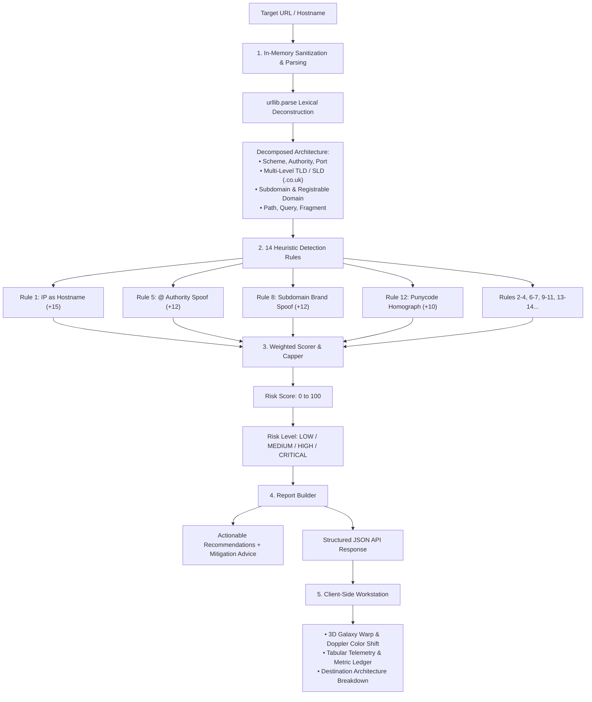
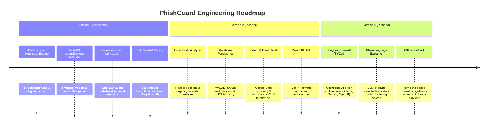

# 🛡️ PhishGuard AI

> **Deterministic Phishing Detection Engine, Threat Architecture Inspector & 3D Celestial Workstation.**  
> Built with Python, FastAPI, Three.js, and human-crafted design tokens inspired by Linear and Raycast.

[](#technology-stack)
[](#technology-stack)
[](#technology-stack)
[-success.svg)](#testing--verification)
[](#license)

---

## 📑 Table of Contents

- [Executive Summary](#-executive-summary)
- [How It Works (The Detection Pipeline)](#-how-it-works-the-detection-pipeline)
- [The 14 Heuristic Detection Rules](#-the-14-heuristic-detection-rules)
- [Scoring Algorithm & Risk Categorization](#-scoring-algorithm--risk-categorization)
- [Technology Stack](#-technology-stack)
- [User Interface & 3D Celestial Engine](#-user-interface--3d-celestial-engine)
- [Keyboard-First Navigation](#-keyboard-first-navigation)
- [Security, OpSec & Privacy Guarantees](#-security-opsec--privacy-guarantees)
- [Project Directory Structure](#-project-directory-structure)
- [API Reference](#-api-reference)
- [Installation & Quick Start](#-installation--quick-start)
- [Testing & Verification](#-testing--verification)
- [3-Stage Product Roadmap](#-3-stage-product-roadmap)
- [License](#-license)

---

## 📌 Executive Summary

Modern phishing campaigns weaponize sophisticated obfuscation techniques: brand squatting in subdomains, zero-width Punycode homographs, `@` authority manipulation, and disposable top-level domains. 

Many naive detectors attempt to solve this by dumping raw URLs into an LLM prompt. This approach is slow, non-deterministic, vulnerable to prompt injection, and generates hallucinations.

**PhishGuard AI takes a fundamentally different engineering approach:**
1. **Deterministic Rule Engine**: Evaluates targets against 14 concrete lexical, grammatical, and architectural heuristics based on Internet standards (RFC 3986, RFC 5890).
2. **Deterministic Risk Scoring (0–100)**: Transparent, reproducible weighted calculations that produce consistent, auditable verdicts.
3. **Zero-SSRF Isolation**: Analyzes targets strictly in-memory without making outbound HTTP requests to untrusted servers.
4. **Human-Centric Interface**: Designed like a high-precision developer tool (Linear / Raycast / Stripe aesthetic), featuring dual Dark/Light palettes, physical keycaps, and a Three.js 3D logarithmic spiral galaxy canvas.

---

## ⚙️ How It Works (The Detection Pipeline)



### Detailed Pipeline Stages

1. **Target Normalization**: Ensures scheme presence (`https://` by default unless explicitly specified), verifies scheme safety, bounds payload length ($\le 2,048$ chars), and lowercases hostname authorities.
2. **Two-Tier Domain Decomposition**: Accurately handles complex two-part second-level domains (e.g., `co.uk`, `com.au`, `co.in`) so that `secure.bank.co.uk` correctly yields `subdomain: secure`, `domain: bank`, `tld: co.uk`, and `registrable_domain: bank.co.uk`.
3. **Parallel Heuristic Evaluation**: Runs each independent rule as a pure function against the parsed dictionary.
4. **Weighted Aggregation**: Sums individual indicator weights and bounds the final score to a maximum of 100.
5. **Telemetry Dispatch**: Emits a structured JSON schema to the frontend, updating the tabular telemetry panel and the 3D WebGL galaxy in real time.

---

## 🎯 The 14 Heuristic Detection Rules

Each rule inspects a distinct vector commonly exploited in credential harvesting and malware campaigns:

| # | Rule Identifier | Weight | Vector Inspected | Security Justification |
|---|-----------------|:------:|------------------|------------------------|
| **1** | `ip_address` | **15** | Hostname is raw IPv4 / IPv6 | Legitimate consumer services use named domains. Attackers deploy bare IPs to bypass domain-based reputation lists and DNS blackholes. |
| **2** | `excessive_subdomains` | **10** | $> 3$ subdomain levels | Adversaries stack subdomains (e.g. `login.verify.account.chase.com.attacker.xyz`) to push the true registrable domain out of mobile address bars. |
| **3** | `suspicious_tld` | **10** | High-risk TLDs (`.xyz`, `.top`, `.buzz`, `.tk`, `.ml`, `.ga`, `.cf`, etc.) | Over 70% of transient phishing campaigns leverage discounted or free registrars with lax KYC policies. |
| **4** | `url_length` | **8** | Normalized length $> 75$ characters | Excessive lengths are engineered to hide malicious paths or pack base64-encoded redirect payloads. |
| **5** | `at_symbol` | **12** | `@` symbol before hostname | RFC 3986 defines `@` as the boundary for userinfo. Browsers treat preceding strings as credentials, navigating to the host *after* the `@` (e.g., `https://google.com@evil.com`). |
| **6** | `hyphen_heavy_domain` | **8** | Domain label has $\ge 3$ hyphens | Attackers chain brand keywords with hyphens (e.g., `secure-login-chase-account-update.com`) to manufacture false legitimacy. |
| **7** | `no_https` | **10** | Plain `http://` scheme | Modern authentication surfaces mandate TLS. Plaintext HTTP indicates an absence of encryption and vulnerability to traffic interception. |
| **8** | `misleading_subdomain` | **12** | Brand name in subdomain, but not in domain | Flags cases like `paypal.com.verification-center.xyz` where a famous brand is placed in the subdomain to trick hurried users. |
| **9** | `encoded_characters` | **10** | Hex percent-encoding (`%`) in hostname | Hex-encoding in hostnames obfuscates true destination characters from URL scanners and human inspection. |
| **10** | `non_standard_port` | **8** | Port present and $\ne 80, 443$ | Standard web traffic operates on ports 80/443. Ports like `8080`, `8888`, or `1337` frequently indicate ephemeral attacker infrastructure. |
| **11** | `suspicious_path` | **7** | Keywords: `/login`, `/verify`, `/account`, `/update`, `/banking`, `/signin` | Credential harvesting landing pages overwhelmingly structure their endpoints around urgent verification paths. |
| **12** | `punycode` | **10** | Hostname contains `xn--` | RFC 5890 IDNA Punycode enables homograph attacks where Cyrillic/Greek characters visually emulate Latin letters (e.g., Cyrillic `а` vs ASCII `a`). |
| **13** | `dangerous_scheme` | **15** | Scheme is `javascript:` or `data:` | Inline execution schemes can trigger Cross-Site Scripting (XSS) or render phishing markup directly in the victim's browser context. |
| **14** | `url_shortener` | **8** | Matches known shorteners (`bit.ly`, `tinyurl.com`, `t.co`, etc.) | Shorteners conceal destination routing, blind email gateways, and obscure malicious targets until click-time. |

---

## 📊 Scoring Algorithm & Risk Categorization

The aggregate risk score is calculated deterministically:

$$\text{Raw Score} = \sum_{i=1}^{N} \text{Weight}_i \quad \text{where rule } i \text{ triggered}$$

$$\text{Risk Score} = \min(\text{Raw Score}, 100)$$

### Severity Thresholds

```
┌──────────────┬───────────────┬────────────────────────────────────────────────────────┐
│ Score Range  │ Risk Category │ Recommended Operational Action                         │
├──────────────┼───────────────┼────────────────────────────────────────────────────────┤
│ 0 – 25       │ LOW           │ Nominal. Verify link context before credential entry.   │
│ 26 – 50      │ MEDIUM        │ Caution. Suspicious indicators flagged. Check sender.  │
│ 51 – 75      │ HIGH          │ High threat. Avoid navigation. Verify out-of-band.     │
│ 76 – 100     │ CRITICAL      │ Critical threat. Do not interact. Block & report link.  │
└──────────────┴───────────────┴────────────────────────────────────────────────────────┘
```

---

## 💻 Technology Stack

### Backend
- **Language**: Python 3.10+ (tested through Python 3.14)
- **Framework**: [FastAPI](https://fastapi.tiangolo.com/) (ASGI asynchronous web framework)
- **Server**: [Uvicorn](https://www.uvicorn.org/) (High-performance ASGI server with uvloop)
- **Validation**: [Pydantic v2](https://docs.pydantic.dev/latest/) (Strict schema parsing & field constraints)
- **URL Engine**: Standard Library `urllib.parse` (Zero external network dependencies)
- **Testing**: [Pytest](https://docs.pytest.org/) & [HTTPX](https://www.python-httpx.org/) (Asynchronous integration testing client)

### Frontend
- **Markup**: Semantic HTML5 (WAI-ARIA accessible dialogs, keycap tags, and collapsible panels)
- **Styling**: Modern CSS3 using custom design tokens (Warm Obsidian/Paper palettes, tabular numbers, crisp 1px borders, inset highlights)
- **Interactions**: Vanilla ECMAScript (Zero bloated runtime frameworks for V1)
- **3D Celestial Engine**: [Three.js](https://threejs.org/) (WebGL rendering 16,000 logarithmic spiral stars with differential rotation and mouse parallax)
- **Typography**: Google Fonts — `Inter` (prose hierarchy) & `JetBrains Mono` (tabular numbers, metrics, code, keycaps)

---

## 🎨 User Interface & 3D Celestial Engine

The interface is engineered to eliminate generic "AI-template" tropes:
- **No Neon Gradients**: Avoids saturated purple-to-cyan fills in favor of a single, purposeful Cobalt accent (`#2563EB`) representing less than 5% of screen real estate.
- **Asymmetrical 70/30 Workspace**:
  - **Main Canvas (70%)**: Houses the 3D celestial canvas, command bar, geometric skeleton loader, and live detection ledger.
  - **Telemetry Inspector (30%)**: Houses real-time risk gauges, numeric scales, target architecture breakdown tables, and engine specifications.
- **Dual Surface Palettes**:
  - **Dark Mode**: Warm Obsidian (`#0A0A0C`), Zinc cards (`#121316`), Deep well (`#0E0F12`), Subtle borders (`rgba(255,255,255,0.07)`).
  - **Light Mode**: Warm Paper/Stone (`#F9F9F8`), Clean elevated surfaces (`#FFFFFF`), Muted wells (`#F1F0EE`), Crisp borders (`rgba(0,0,0,0.08)`).
- **Interactive 3D Spiral Galaxy (`js/galaxy3d.js`)**:
  - Models 16,000 stars distributed across 3 logarithmic spiral arms: $r = a \cdot e^{b\theta}$.
  - Features Keplerian differential rotation where stars closer to the core rotate faster.
  - Interactive mouse drag to orbit the galaxy disc in 3D space with damping physics.
  - **Doppler Telemetry Shift**: The galactic nucleus dynamically shifts its color temperature based on evaluated risk:
    - 🟢 `LOW`: Quiet Emerald (`#10B981`)
    - 🟡 `MEDIUM`: Solar Amber (`#F59E0B`)
    - 🟠 `HIGH`: Warm Orange (`#F97316`)
    - 🔴 `CRITICAL`: Deep Crimson (`#EF4444`)

---

## ⌨️ Keyboard-First Navigation

Built for rapid triage without taking your hands off the keyboard:

| Shortcut | Action | Description |
|:---:|---|---|
| <kbd>⌘K</kbd> / <kbd>Ctrl+K</kbd> / <kbd>/</kbd> | **Focus Command Bar** | Instantly selects and highlights the URL input field |
| <kbd>↵ Enter</kbd> | **Inspect Target** | Dispatches the heuristic analysis pipeline |
| <kbd>Esc</kbd> | **Clear / Close** | Clears the input field or dismisses open modals |
| <kbd>T</kbd> | **Toggle Theme** | Switches seamlessly between Dark (Obsidian) and Light (Paper) modes |
| <kbd>L</kbd> | **Literature Modal** | Opens the Security Standards, RFC Citations & OpSec Field Guide |
| <kbd>1</kbd> | **Preset 1** | Loads & scans safe target (`google.com`) |
| <kbd>2</kbd> | **Preset 2** | Loads & scans shortener target (`bit.ly/secure-login-391`) |
| <kbd>3</kbd> | **Preset 3** | Loads & scans brand spoof (`paypal-update.example.xyz`) |
| <kbd>4</kbd> | **Preset 4** | Loads & scans raw IP target (`http://192.168.1.1:8080/login`) |

---

## 🔒 Security, OpSec & Privacy Guarantees

### 1. Zero-SSRF Architectural Isolation (CWE-918)
A critical flaw in many online URL scanners is that the backend server executes an HTTP `GET` request or launches a headless browser to screenshot the submitted page. Attackers exploit this to mount **Server-Side Request Forgery (SSRF)** attacks against private cloud metadata services (e.g., AWS/GCP `http://169.254.169.254`), container control planes, or intranet services.

> [!IMPORTANT]
> **PhishGuard AI NEVER fetches, connects to, or sends network traffic to submitted URLs.**  
> Target parsing is executed exclusively in-memory using deterministic lexical deconstruction via Python's standard library.

### 2. Data Minimization (GDPR Art. 5(1)(c))
- Target inspection in Version 1 is 100% stateless and evaluated in transient RAM.
- No client URLs, browser user agents, or submitted payloads are cataloged, tracked, or saved to third-party ad networks.

### 3. Integrated Security Literature Field Guide (<kbd>L</kbd>)
The application includes an in-app reference library citing authoritative standards:
- **RFC 3986**: URI Syntax & Authority Grammar
- **RFC 5890 / 5891**: Internationalized Domain Names & Punycode (`xn--`)
- **RFC 6265bis & RFC 6797**: Cookie Scoping & HSTS Strict Transport Security
- **NIST SP 800-63B**: Digital Identity Guidelines & Verifier-Impersonation Resistant MFA (FIDO2/WebAuthn)
- **MITRE ATT&CK T1566.002**: Adversary Spearphishing Link execution procedures

---

## 📁 Project Directory Structure

```
phishgaurd ai/
├── backend/
│   ├── __init__.py
│   ├── main.py                  # FastAPI application entry point, CORS & static mounts
│   ├── api/
│   │   ├── __init__.py
│   │   └── routes/
│   │       ├── __init__.py
│   │       └── analysis.py      # POST /api/analyze route definition
│   ├── core/
│   │   ├── __init__.py
│   │   ├── config.py            # Thresholds, brand dictionaries & suspicious TLD lists
│   │   └── models.py            # Pydantic v2 request/response validation schemas
│   ├── engine/
│   │   ├── __init__.py
│   │   ├── url_parser.py        # Lexical parser, SLD extractor & scheme validator
│   │   ├── rules.py             # 14 standalone pure-function heuristic detection rules
│   │   ├── scorer.py            # Weighted aggregate score calculator (0-100)
│   │   └── report.py            # Structured report & executive summary builder
│   └── tests/
│       ├── __init__.py
│       ├── test_url_parser.py   # Unit tests for URL deconstruction & edge cases
│       ├── test_rules.py        # Unit tests covering all 14 detection rules
│       ├── test_scorer.py       # Unit tests for scoring logic & boundary thresholds
│       └── test_api.py          # Asynchronous endpoint & integration tests with HTTPX
├── frontend/
│   ├── index.html               # Semantic HTML5 single-page application & modal drawer
│   ├── css/
│   │   └── style.css            # Human-crafted design tokens (Dark/Light palettes & layout)
│   └── js/
│       ├── galaxy3d.js          # Three.js 16k-particle logarithmic spiral galaxy engine
│       └── app.js               # Keyboard shortcuts, DOM controller & API bridge
├── pytest.ini                   # Pytest async configuration
├── requirements.txt             # Python dependency specifications
├── .gitignore                   # Version control exclusions
└── README.md                    # Project documentation
```

---

## 📡 API Reference

### `POST /api/analyze`
Submits a candidate URL or hostname for heuristic analysis.

#### Request Headers
`Content-Type: application/json`

#### Request Body
```json
{
  "url": "https://paypal-update.example.xyz:8080/verify?account_id=98124"
}
```

#### Response (`200 OK`)
```json
{
  "url": "https://paypal-update.example.xyz:8080/verify?account_id=98124",
  "risk_score": 37,
  "risk_level": "MEDIUM",
  "indicators": [
    {
      "rule": "suspicious_tld",
      "description": "The TLD '.xyz' is commonly abused by phishing campaigns.",
      "weight": 10
    },
    {
      "rule": "misleading_subdomain",
      "description": "Subdomain contains the brand name 'paypal' but the registrable domain 'example.xyz' does not belong to that brand.",
      "weight": 12
    },
    {
      "rule": "non_standard_port",
      "description": "URL specifies non-standard port 8080, which is unusual for legitimate websites.",
      "weight": 8
    },
    {
      "rule": "suspicious_path",
      "description": "URL path contains the suspicious keyword '/verify'.",
      "weight": 7
    }
  ],
  "parsed_url": {
    "scheme": "https",
    "hostname": "paypal-update.example.xyz",
    "path": "/verify",
    "query": "account_id=98124",
    "port": 8080,
    "fragment": ""
  },
  "analysis_summary": "This URL exhibits some characteristics that may be associated with phishing. Exercise caution.",
  "recommendation": "Exercise caution. Verify the sender and navigate to the official website directly rather than clicking links.",
  "timestamp": "2026-10-26T22:30:00.000000+00:00"
}
```

#### Error Response (`400 Bad Request`)
```json
{
  "detail": "URL must not be empty."
}
```

---

### `GET /api/health`
Liveness check probe.

#### Response (`200 OK`)
```json
{
  "status": "ok",
  "version": "1.0.0"
}
```

---

## 🚀 Installation & Quick Start

### 1. Prerequisites
- **Python 3.10 or newer** installed on your system.
- Modern web browser with WebGL support (Chrome, Firefox, Safari, Edge).

### 2. Clone & Setup Virtual Environment

#### Windows (PowerShell)
```powershell
# Navigate into the project folder
cd "phishgaurd ai"

# Create a virtual environment
python -m venv venv

# Activate the virtual environment
.\venv\Scripts\Activate.ps1

# Install dependencies
pip install -r requirements.txt
```

#### macOS / Linux (Bash)
```bash
cd "phishgaurd ai"
python3 -m venv venv
source venv/bin/activate
pip install -r requirements.txt
```

### 3. Launch the Application

```bash
python -m uvicorn backend.main:app --reload --port 8000
```

Open your browser to:
👉 **[http://localhost:8000](http://localhost:8000)**

---

## 🧪 Testing & Verification

The project includes an automated test suite verifying every layer of the architecture:
- `test_url_parser.py`: Multi-subdomain decomposition, port detection, whitespace stripping, and scheme validation.
- `test_rules.py`: Independent unit tests for all 14 heuristic detection rules.
- `test_scorer.py`: Score aggregation, boundary capping at 100, and threshold classifications.
- `test_api.py`: Asynchronous API tests via `httpx.AsyncClient`, verifying JSON schemas and static asset serving.

To run the full test suite:
```bash
python -m pytest -v
```

Expected output:
```text
============================= test session starts =============================
collected 65 items

backend/tests/test_api.py::TestAnalyzeEndpoint::test_valid_url PASSED    [  1%]
...
backend/tests/test_rules.py::TestRunAllRules::test_suspicious_url_returns_multiple_indicators PASSED [ 58%]
...
backend/tests/test_url_parser.py::TestExtractDomainParts::test_multi_subdomain PASSED [100%]

============================= 65 passed in 1.25s ==============================
```

---

## 🗺️ 3-Stage Product Roadmap



---

## 📄 License

This project is licensed under the [MIT License](LICENSE).  
Built for cybersecurity research, developer education, and defensive threat analysis.
